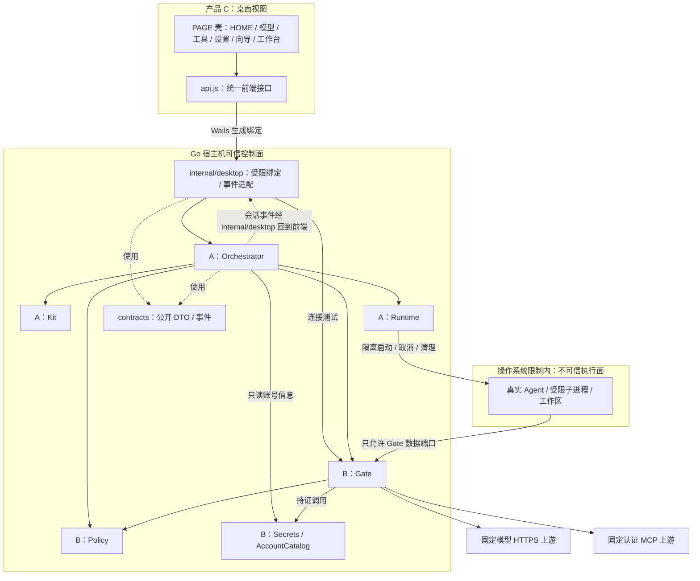

# 两天版模块设计与并行开发

本文件定义 Go/Wails 包边界、替身与文件归属。V1 **架构总纲与 ABC 分工**见 [SYSTEM-DESIGN.md](SYSTEM-DESIGN.md)；方法与数据以 [CONTRACT.md](CONTRACT.md) v1.2 为唯一来源；屏级绑定见 [PAGE-DESIGN §9](PAGE-DESIGN.md#9-与架构-api-的绑定)。目录见 [DIRECTORY-STRUCTURE.md](DIRECTORY-STRUCTURE.md)。本分支（`feat/page-design-full`）以 PAGE-DESIGN 全量为准，含 OAuth/clone/PTY。

## 1. 检查结论与补齐范围

检查时已有架构图、目录和模块 README，但接口停留在示意：缺少准确签名、前端错误/事件字段、端口授权传递、资源所有权和替身交付约定。仅凭原文档并行实现会在联调阶段重新设计这些边界。

本轮以接口规格补齐这些缺口，并明确原先的 MountWorkspace 已合并到 Runtime.Create、一个会话对应一个任务、Stop 异步确认清理、回滚成功的 failed 会话可释放锁。这些约定不能继续按旧示意各做一套。

**文档能消除因依赖对方实现而等待的设计阻塞，不能保证零集成风险。** 共享契约首次合入、Wails 构建环境、真实隔离能力、账号和真实上游仍是客观依赖。未完成技术检查点前不宣称“可以无条件互不阻塞”。

## 2. 架构与依赖

图中服务调用与包依赖需区分：Gate 使用 PolicySnapshot 判定授权，不调用 Runtime；Kit 接收编排映射出的 URL/Sentinel，不导入 Gate。Runtime 不导入 Kit，LaunchSpec 由 Runtime 定义、Kit 返回。运行时边界由操作系统强制执行，Go 接口本身不是安全隔离。

## 3. 模块边界矩阵

| 模块 / 负责人 | 唯一负责 | 输入 → 输出 | 明确不负责 | 可独立验证 |
|---|---|---|---|---|
| contracts / A 首次合入、B 复核、C 核对 | 可序列化 DTO、公开错误与事件 | Go 定义 → 生成前端模型 | 业务状态机、IO、内部服务句柄 | JSON 示例与字段校验 |
| main.go/internal/desktop / B | Wails 生命周期、白名单绑定、错误转换与事件桥接 | 固定 DTO → Response / harbor:event | 再造状态机、任意命令/文件接口 | 注入假 SessionService/Connections |
| frontend / C | 表单、输出、状态展示、提示与用户操作 | api.js 方法/事件 → 视图 | Gate/上游调用、密钥持久化、Go 逻辑 | 浏览器独立 mock transport |
| orchestrator / A | 会话锁（本分支目标≤2）、生命周期、clone、PTY、扩权、取消回滚与终态 | SessionSpec + 注入服务 → Snapshot / Event | 存真凭据、解析 MCP/OAuth、编写系统隔离规则 | 注入假 Gate/Policy/Runtime/Kit/Catalog |
| runtime / A | 私有 HOME、配置落盘、OS 约束、进程树及临时数据 | RuntimeSpec + LaunchSpec → Handle / Process / 输出 | 账号、MCP 授权、UI、模型协议 | 真实 profile + 无敏感受限探测程序 |
| kits / A | CLI 检测、版本能力、启动配置生成 | KitInput → LaunchSpec | 宿主机直接执行任务、读 Secrets、创建 Gate | 固定输入快照与受限实际 Agent |
| policy / B | 规范化工作区、固定 profile、目标/工具白名单快照 | PolicyRequest → PolicySnapshot | 网络转发、启动进程、持久授权库 | 临时目录、符号链接、未授权目标 |
| gate / B | 流式模型反代、真实 MCP 协议、Sentinel、在途调用及监听器 | GateSpec + 账号引用 → GateBinding / 审计 | Agent 生命周期、控制 API、动态扩权 | 受控认证上游和真实只读 MCP 分层验证 |
| secrets / B | 主机内存凭据、账号元信息与窄接口 | 候选连接成功后保存 → ID / 只读信息 | UI 回显、Agent env、浏览器存储 | 内存实例、失效引用、失败不存储 |
| security / A 主责 | 跨边界真实安全验收与结果记录 | 实际应用/隔离进程 → 可复现结果 | 用 fixture 成功替代真实兼容性 | 按 ACCEPTANCE.md 记录每项证据 |

内存存储必须只向 A 注入 AccountCatalog.Lookup，不能给编排层一个带 Resolve 的“大服务对象”。构造参数使用窄接口，避免模块获得不需要的能力。

## 4. 资源所有权与装配

| 资源 | 创建/持有方 | 正常关闭 | 失败处理 |
|---|---|---|---|
| Wails 窗口、全局应用 context | B，main.go 与 internal/desktop | 应用退出调用编排 Shutdown，完成后退出 | Shutdown 错误必须报告，不能只关闭窗口忽略 Agent |
| 会话 ID、锁、状态、事件 seq | A，Orchestrator | 资源清理确认后释放 | failed 且 cleanupComplete=false 保留锁 |
| Sentinel、回环监听器、MCP/HTTP 连接 | B，Gate | Revoke 本地失效并取消、关闭 | Start 部分失败也自行释放；致命回调交编排清理 |
| 私有 HOME、profile、Agent 进程树 | A，Runtime | Destroy 确认终止并移除 | Exec 部分失败清理子资源，编排仍兜底 Destroy |
| 账号与上游真实凭据 | B，Secrets | 应用退出释放 | 连接失败不保存；会话停止只撤销能力 |
| 事件监听与页面输出缓存 | C，api.js/视图 | 卸载取消订阅，尾部缓存有上限 | 状态丢失调用 GetSession 恢复，不伪造 running |

装配仅做一次：A 在 orchestrator 提供业务构造函数，B 在 main.go 与 internal/desktop 创建具体组件并注入，A 不修改 Wails 初始化文件；B 不进入 session.go 重写状态。应用退出清理可使用新 context，不能沿用已取消的会话 context。

## 5. 并行开发的替身约定

以下替身已落地；真实与替身均遵循同一契约，不能用替身通过替代真实上游验收。

| 消费方 | 不等待的真实模块 | 替身归属与固定行为 | 切回真实的条件 |
|---|---|---|---|
| C 的页面 | Wails/Go/真实网络 | C 写 frontend/src/mock-api.js；方法和事件与 api.js 完全一致，显式显示“模拟模式” | B 生成绑定后，只替换 api.js transport；视图不改方法/字段 |
| A 的编排 | B 的 Gate/Policy/Catalog | A 写自己 *_test.go 中的内存 fake，签名严格遵循 CONTRACT.md | B 提供实现并通过提供方检查，不改 A 的调用接口 |
| B 的 Wails 桥 | A 的会话实现 | B 在后端测试中实现 fake SessionService，检查绑定返回与事件映射 | A 导出构造函数后注入真实服务 |
| B 的代理/网关 | 外部模型与 MCP | B 在测试中启动本机受控认证上游，覆盖流、401、超时和取消 | 通过后用已登记真实账号验证；不把 fixture 标为兼容通过 |
| A 的 Runtime | 模型和 MCP | A 启动无敏感回环测试监听器，只供精确端口放行探测 | profile 验证后注入真实 Gate.AllowedTCP |

前端 transport 最小接口为 listAgents、selectWorkspace、connectModel、connectMcp、createSession、getSession、stopSession、onEvent。全部业务调用返回 Promise<Response>；onEvent(callback) 返回取消函数，事件载荷就是 CONTRACT.md 的 Event，不再套一层。Wails transport 包装 PascalCase 生成方法；mock transport 不导入生成绑定，可在普通浏览器独立启动。

前端固定 mock 数据：Agent id=claude、codex 或 dsh，模型 profileId 分别为 demo-model、codex-model 或 dsh-model；MCP id=mock-mcp、profileId=demo-mcp；工作区=/demo/project。不得放真实 Key。正常创建返回 provisioning，依次推送 running、文本 output、MCP allowed 审计、stopping、stopped；State/Error 字段及 seq 严格遵循契约。脚本可重复执行并支持提前 Stop；另外提供认证失败、SESSION_BUSY、ISOLATION_UNAVAILABLE、cleanupComplete=false 四个可选场景。所有 mock 只验证 UI/协议处理，不进入正式执行面。

Go 的 fake 同样覆盖成功、Start/Create/Exec 失败、Stop 与 provisioning 竞争、清理失败等，不访问真实 Secrets。假 Runtime 不能用普通宿主机 shell 作为实际隔离运行降级。生产入口不自动回退任何 fake，模拟与真实运行明确切换，正式安全验收必须禁用 mock。

## 6. 文件归属与共享变更

| 文件范围 | 唯一主改方 | 其他人如何配合 |
|---|---|---|
| internal/contracts、CONTRACT.md | A 首次落地；B 复核绑定兼容性 | C 提字段需求；共享变更先更新契约再同步双方，不各自复制 |
| internal/orchestrator、runtime、kits、security | A | B/C 通过接口及验收反馈协作 |
| 根 Go/Wails 配置、main.go 与 internal/desktop、gate/policy/secrets、build | B | A 提供业务构造函数，不同时修改入口 |
| frontend/package.json 及构建/生成配置 | B 初始化 | C 通过已提供脚本开发，改依赖先与 B 协调 |
| frontend 手写视图、api.js/mock-api.js、demos | C | B 配合生成绑定，A/B 不另起一套页面 |
| 生成的 frontend/bindings | B 负责生成，三人都不手改 | 从 Go DTO/绑定重建，不能拷贝修改绕过生成问题 |

所有人先使用共同确认的 Go module path。B 在首小时交付 go.mod 与 Wails 构建骨架，A 同期落契约，二者需要一次短暂同步；不能假装这一步完全无依赖。之后每人只提交自己的模块和必要共享契约变更，避免整仓格式化造成冲突。

## 7. 检查点与阻断处置

| 时间 | A 可交付 | B 可交付 | C 可交付 | 放行条件 |
|---|---|---|---|---|
| 首小时 | DTO/消费接口骨架、编排构造边界 | module、Wails 骨架、生成绑定入口 | 确认任务/页面字段，mock 接口需求 | 名称/字段/错误统一，仓库可独立编译或明确记录阻断 |
| 第 3 小时 | 真实 profile 安全探测；编排 fake 测试可运行 | 模型/MCP 实验、Wails 方法与事件可调用 | 浏览器 mock 两页可操作 | 三条路径有证据；接口桩可替换 |
| 第一天结束 | Runtime/Kit/编排真实实现 | 真实 Gate、连接服务和桌面桥 | 页面使用真实 transport | Agent 经模型和认证 MCP 完成一次任务 |
| 第二天上午 | 停止/失败/清理回归 | 认证/超时/撤销及构建验证 | 真实错误和再次运行验收 | ACCEPTANCE 必过项有记录 |

一个检查点未过，负责人记录失败证据、影响模块和下一步；其他人继续用同契约替身开发。接口可用性问题由 A/B 当场解决；外部凭据/机器问题不能靠修改签名掩盖。第 3 小时隔离仍无法成立则重估演示范围，不降低安全边界冒充成功。

当前状态：共享 Go 类型、编排及其测试 fake 已落地；严格单进程 Runtime/Kit 已实现，不代表子进程能力完成；**C 的浏览器 mock 两页与场景替身已落地**（见 [DEV-C.md](DEV-C.md)），Wails v3 绑定、构建和原生桌面冒烟已通过；真实上游任务仍待完成。A 证据见 [DEV-A.md](DEV-A.md)。能按契约并行开发，不代表已经完成可运行交付或消除外部集成风险。

2026-10-25 修复：连接测试由 SessionService.WithConnection 与 Create 原子互斥，桌面不再维护 busy 副本。退出在 ShouldQuit/窗口关闭钩子中异步确认 Shutdown；失败保留窗口，成功后才清空凭据并退出。修复与证据见 [ABC 审查](archive/ABC-INTEGRATION-REVIEW.md#修复进展)。

2026-10-26：`WithConnection` 不再因已有 running 会话拒绝 Connect——新增模型/MCP 只写本机账号表；仅与并发 Connect、以及 provisioning 中的 Create 互斥。

2026-10-26：自定义 MCP（填 Origin）经 `CustomMCPProbeCandidates` 探测；成功须落盘 `AccountInfo.tools`；Policy.Build 用该列表作白名单。缺 tools 或误填模型 `/v1` 地址分别对应 `INVALID_ARGUMENT` / `UPSTREAM_UNAVAILABLE`。Policy 校验失败不再一律映成 `WORKSPACE_DENIED`。

## dsh 范围增量（2026-10-25）

A 新增 `internal/kits/dsh` 与 Runtime 专用安装目录校验；B 装配双 Kit、独立 dsh-model 和受信模型路径前缀；C 页面选择 Agent 并清空旧模型引用。DTO 新增可选 modelProfileId，真实桌面与 mock 均消费，状态机与资源所有权不变。版本、安装与证据见 [dsh 适配](DSH-INTEGRATION.md)。
