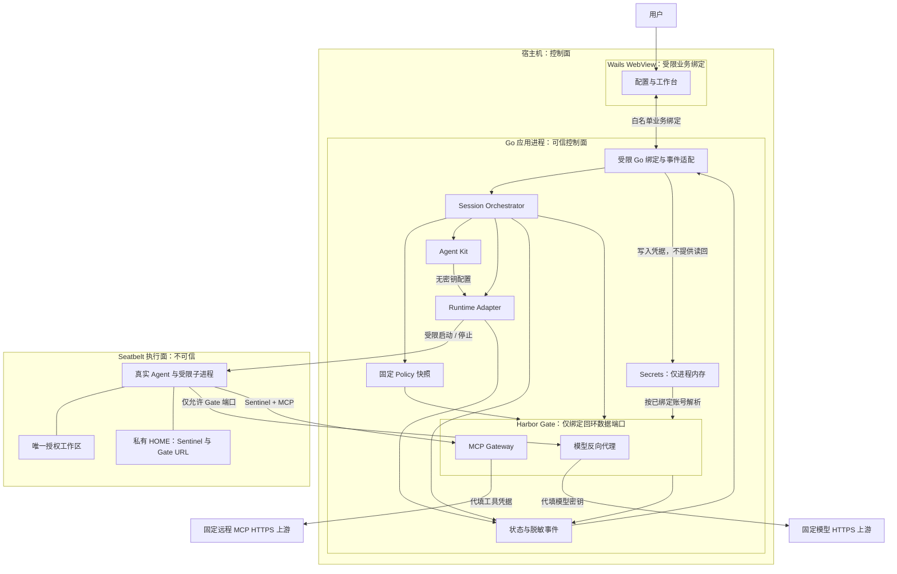
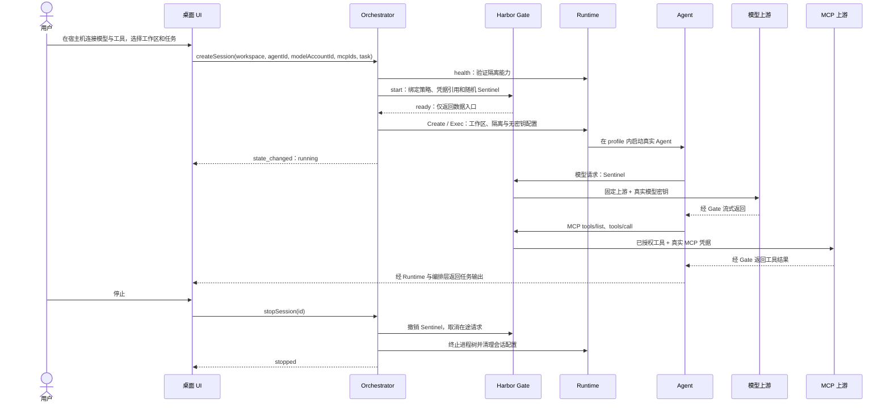

# Agent Harbor：三人两天核心架构与模块划分

> **分支注意（`feat/page-design-full`）**：本文描述的是**历史两天裁剪**。本分支产品/接口/分工以 [PAGE-DESIGN](../PAGE-DESIGN.md)、[CONTRACT v1.2](../CONTRACT.md)、[SYSTEM-DESIGN v2](../SYSTEM-DESIGN.md)、[TASK-SPLIT v2.0](TASK-SPLIT-ABC.md) 为准；**不要**按下文「延后」列砍掉 OAuth / clone / PTY / 双会话 / 完整 HOME。

本文是两天演示版的建议实施方案，收敛完整产品设计，不替代长期架构。目标是可重复演示的真实闭环，不承诺两天内支持全部主流 Agent、MCP 或生产级安全认证。

## 1. 交付边界与技术选择

**必须交付：桌面填写凭据 → 选择工作区 → 隔离启动一个真实 Agent → 通过宿主机调用模型与一个带认证 MCP → 展示结果和安全边界 → 停止并清理。** MCP 是本议题核心，不能按旧三天 Spike 将其砍掉。

以团队有 macOS 开发机为前提，建议只支持同一款 macOS 版本及 CPU 架构；开工前记录具体版本。技术栈为 Go + Wails v3.0.0-beta.34，前端使用简单 HTML/CSS/JavaScript；Go 统一承担编排、进程、HTTP 与 MCP 网关，MCP 使用现有 Go SDK，Python 仅用于安全验收和演示辅助。不引入数据库、微服务或自研协议栈。

| 项目 | 两天版本 | 延后 |
|---|---|---|
| Agent | Claude Code 优先；开工前确认 CLI、合法可用的模型账号及协议组合；Codex/dsh 复用 Kit 接口 | 另外两个 Agent 的完整验收 |
| Runtime | macOS `sandbox-exec` / Seatbelt profile，强制限制文件、网络、进程与 IPC；须真机验证 | Linux、Windows、容器、microVM |
| 模型 | 一个已验证的协议与固定上游，显式 Base URL 反向代理，支持流式响应 | 任意供应商切换、通用 HTTPS MITM |
| MCP | 一个实际可访问、带测试凭据的远程 Streamable HTTP MCP；一次真实 `tools/list` 与 `tools/call` | OAuth、SSE 旧传输、本地 stdio、密码型及多字段认证（**注**：当前 main 已支持 OAuth 与宿主 stdio 桥；本表为历史两天裁剪） |
| 工作区 | 专门的演示目录，`direct` 读写；界面明确标注会修改原文件 | clone、导回与任意敏感工作区 |
| 会话 | 同时仅 1 条；一次任务输入与输出展示，Agent 使用非交互模式 | 双会话、恢复、完整交互式 PTY |
| 凭据 | 宿主机 Go 后端内存保存，重启重新填写；不写浏览器存储或配置文件 | Keychain 持久化、轮换管理 |
| 界面 | 配置/连接检测、运行工作台两个视图；错误与拒绝记录 | 完整 HOME、设置、复杂权限管理 |
| 网络授权 | 预先固定允许的模型和 MCP 上游，其余拒绝并显示原因 | 扩权弹窗、长期记忆与撤销 |

上述缩减仅适用于演示版：单会话上限 1 不改变完整 V1 上限 2；direct 和内存密钥是明确取舍，不应被描述成已交付 clone 或钥匙串能力。用户仍在宿主机界面填写敏感信息，沙箱始终不填真实凭据。

## 2. 部署与信任边界架构图



除 Wails 管理的 WebView 外，团队主要管理 Go 应用进程与 Agent 进程；Agent 子进程继续受同一沙箱约束。Policy、Secrets、Gate 是内部 Go 包，不拆成独立服务。前端只加载本地受信资源，限制导航并配置 CSP；internal/desktop 仅绑定固定业务方法，禁止任意命令执行和通用文件访问，不直接绑定 Runtime、Gate 或 Secrets。

Gate 只开放数据入口，不提供控制、凭据读取、任意目标 URL 或配置修改接口。控制走 Wails Go 绑定，不另开 HTTP 管理端口。Go 后端不得加载远程页面或在 Gateway 中执行 MCP 返回的代码；不得将密钥通过命令行参数传给 Agent。

## 3. 两条数据路径与启动顺序



**模型代理采用应用层反向代理**：Kit 将经过验证的 Agent 模型 Base URL 指向回环 Gate；Gate 终止本地请求后建立到固定上游的 HTTPS 连接。这样不需要安装 MITM 根证书。它只覆盖已适配的模型协议，不是通用正向代理；Agent 的其他联网请求由 Runtime 拒绝。

**MCP 代理保留协议语义**：使用 SDK 实现 Agent 到 Gateway、Gateway 到上游的两段连接，处理初始化、工具发现、调用与取消。首版只挂载一个服务器，避免多服务器工具命名冲突。不得以自建普通 REST 工具接口冒充 MCP；必须由实际 Agent 成功调用。

状态采用 `idle → provisioning → running → stopping → stopped`，准备或运行异常进入 `failed`。一个会话对应一次非交互任务，创建时提交任务文本，Agent 正常退出后也走停止清理流程；再次运行创建新会话。Gate 故障或 Runtime 失效进入停止/清理流程，禁止直连回落；单次上游 401、超时等返回明确错误，不能自动扩大权限。清理失败保留失败状态并阻止新会话，避免残留进程被忽略。

## 4. 模块划分与三人职责

| 负责人 | 模块与目录 | 对外交付 | 不承担 |
|---|---|---|---|
| A：隔离、Agent 与编排 | `internal/runtime/`、`internal/kits/`、`internal/orchestrator/`、`security/` | profile、私有 HOME、进程树清理；真实 Kit；状态机、业务装配和回滚；隔离负例 | UI、上游认证与 MCP 协议 |
| B：Gate、凭据与桌面后端 | `internal/gate/`、`internal/secrets/`、`internal/policy/`、main.go/internal/desktop 与构建配置 | 模型流式反代、MCP Gateway、Sentinel、策略；Wails 绑定/事件及构建环境 | 会话状态机、桌面页面 |
| C：产品与前端 | `frontend/`、`demos/` | 两视图、范围收敛、产品验收与演示；前端联调 | Go 编排、协议、隔离与构建故障处理 |
| A/B 确定，C 核对 | `internal/contracts/` | 统一 DTO、错误码和事件；B 生成 Wails 绑定；首小时冻结 | 各目录自行定义同名接口 |

建议目录结构如下；目录为模块边界，不是单独部署单元。

```text
main.go / internal/desktop              # B：Wails 启动、受限绑定和事件适配
internal/
  contracts/                 # A/B 定义，C 核对前端数据需求
  orchestrator/              # A：生命周期、装配及回滚
  runtime/                   # A：系统强制隔离
  kits/claude/               # A：首个真实 Agent
  gate/                      # B：模型代理与 MCP Gateway
  policy/                    # B：固定授权快照
  secrets/                   # B：宿主机内存凭据
frontend/src/                # C：配置、工作台与绑定调用封装
security/                    # A 主责，B/C 配合
```

具体目录、根入口与生成产物约定见 [Go/Wails 目录设计](../DIRECTORY-STRUCTURE.md)。

## 5. 首小时冻结的最小契约

精确方法、Go 签名、JSON 字段、事件与错误、取消和资源语义统一维护在 [CONTRACT.md](../CONTRACT.md)，不在本文重复声明。模块职责、依赖、替身与共享文件归属见 [MODULE-DESIGN.md](../MODULE-DESIGN.md)。

- 前端方法为 ListAgents、SelectWorkspace、ConnectModel、ConnectMcp、CreateSession、GetSession、StopSession；api.js 对页面提供对应 camelCase 包装。
- 会话事件统一为 harbor:event，按 sessionId 和 seq 标识；类型载荷不能夹带内部凭据或句柄。
- Gate Start 返回精确的 AllowedTCP，Runtime Create 一次配置工作区、私有 HOME 与隔离规则；本版不单独调用 MountWorkspace。
- Create/Stop 快速返回快照，实际执行及清理通过事件确认；任务 context 由应用生命周期派生。
- 失败且清理完成可释放锁；清理失败保留锁，避免残留进程与新会话并行。
- 具体环境与真实接入项见 [DECISIONS.md](../DECISIONS.md)，必须保留待验证状态；可执行验收见 [ACCEPTANCE.md](../ACCEPTANCE.md)。

## 6. 两日排期与集成检查点

按每天约 8 小时有效开发估算，共 48 人时，表内包含集成和验证。前提是现成 Go/Wails/Node 开发环境、Agent CLI、依赖下载以及可用测试账号；签名、公证、安装包自动更新不在两天承诺内。

| 时间 | A：Runtime / Kit / 编排 | B：Gate / MCP / Wails 后端 | C：产品 / 前端 | 检查点 |
|---|---|---|---|---|
| Day 1，0–1h | 三人共同确认目标机器、Agent/模型组合、真实 MCP 及最小契约 | 建 Wails 骨架及 Go 契约 | 定稿页面和验收任务 | 依赖可安装、测试凭据可用；冻结范围 |
| Day 1，1–3h | 验证 profile：授权文件可写、敏感路径/非 Gate 网络/控制 IPC 被拒 | 模型/MCP 验证；Wails 构建、绑定与事件 | 用模拟事件完成配置视图和工作台 | 最危险的三个可行性点同时有证据 |
| Day 1，3–6h | 净化环境、Kit、编排与实际 Agent 启动 | 接通 Sentinel/MCP，提供页面绑定与事件 | 页面接真实绑定，完善交互 | 必须开始三人合流，停止单独扩功能 |
| Day 1，6–8h | 与 B/C 排查 Agent 在沙箱内的协议与文件依赖 | 配合实际 Agent 请求 | UI 输入任务、显示真实输出 | 当天跑通 Agent→Gate→模型及 MCP |
| Day 2，0–3h | 停止、回滚、清理、隔离负例 | 认证错误、超时、错误脱敏与构建 | 工作台、边界说明、产品验收 | 完整启动/使用/停止闭环 |
| Day 2，3–5h | 配合安全回归 | 配合安全回归 | 连续演示与错误恢复 | 连续两轮全流程通过 |
| Day 2，5–8h | 修阻断问题 | 修阻断问题 | 准备演示脚本、录屏、依赖说明 | 冻结功能，保留 3h 缓冲 |

**时间不足的删减顺序**：样式 → 第二个 MCP → Codex/dsh 适配 → 活动统计。不能删除唯一真实 Agent、唯一认证 MCP、隔离强制、凭据外置或停止清理。禁止通过改用宿主机 shell、只跑 curl 或展示假 MCP 成功来宣称核心闭环完成。

首日第 3 小时若 Runtime 无法证明强制隔离，立即记录阻断并重估交付；不要临时启动另一套未经验证的后端。只有团队已有可用且满足同样边界的容器运行模板时，才可明确调整方案。上游不可用可用受控认证 MCP fixture 验证网关机制，但必须标为测试结果，不能计作真实生态兼容验收。

## 7. 验收清单与演示

| 必过项 | 证据 |
|---|---|
| 实际 Agent 运行 | 展示 CLI 版本、受限进程及模型任务结果，不以普通 shell 代替 |
| MCP 零沙箱填密 | 只在宿主机工具视图连接凭据；Agent 完成工具发现和一次真实认证调用 |
| 凭据不入执行面 | 使用可轮换测试凭据检查 Agent 环境、私有 HOME/配置；仅有 Sentinel，无真实模型/MCP 密钥；结果脱敏 |
| 文件隔离 | 工作区正常读写；宿主机专设的工作区外测试文件、敏感路径和钥匙串不可读 |
| 网络隔离 | 直接 IP、普通域名、自启客户端与非 Gate 回环端口访问被 Runtime 拒绝，不能仅以 Gate 返回拒绝充数 |
| Gate 权限 | 错误、已撤销 Sentinel 被拒；固定上游与工具列表不可被 Agent 改写；重定向不泄露凭据 |
| 无特权通道 | 不暴露宿主机控制 IPC、Docker socket、sudo 授权；用无害权限检查验证，禁止在真实宿主机执行关机命令 |
| 失败关闭 | 缺失 profile、Runtime 检测失败或 Gate 启动失败时不运行 Agent；Gate 运行中故障触发停止 |
| 可清理可重跑 | 停止撤销授权、取消在途调用、清理进程树和私有配置；第二轮新会话可正常运行 |
| 用户可理解 | 全流程在桌面完成，不要求用户编辑 JSON、设置代理端口或输入 Docker 命令 |

建议演示顺序：宿主机连接模型和工具 → 选择非敏感演示项目 → Agent 完成一个包含 MCP 查询和项目文件修改的小任务 → 查看 Gate 审计 → 展示拒绝访问测试 → 停止并再次启动。准备一条稳定的测试数据与工具调用，使用只读 MCP 操作，避免给演示引入外部写入副作用。

边界必须如实说明：本版证明一个平台、一个 Agent/模型组合、一个 MCP 的核心路径；未证明全部主流生态兼容。授权工作区中的文件仍可能被修改或发送给已授权服务；上游返回内容是否夹带敏感信息需要另行治理，不能以“凭据不写配置”推导绝对不会发生任何敏感信息回流。
